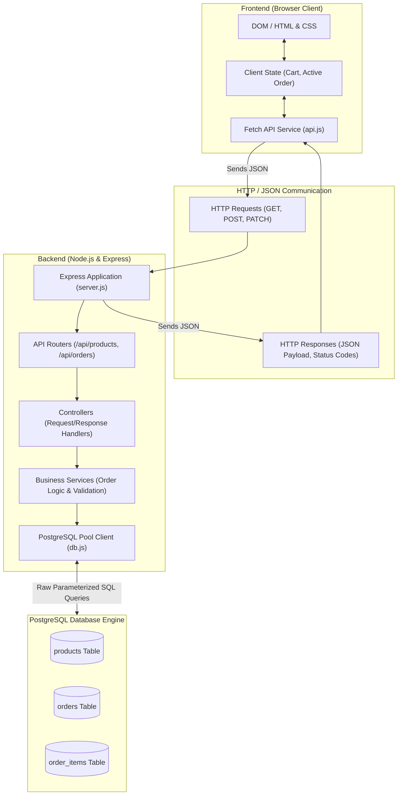
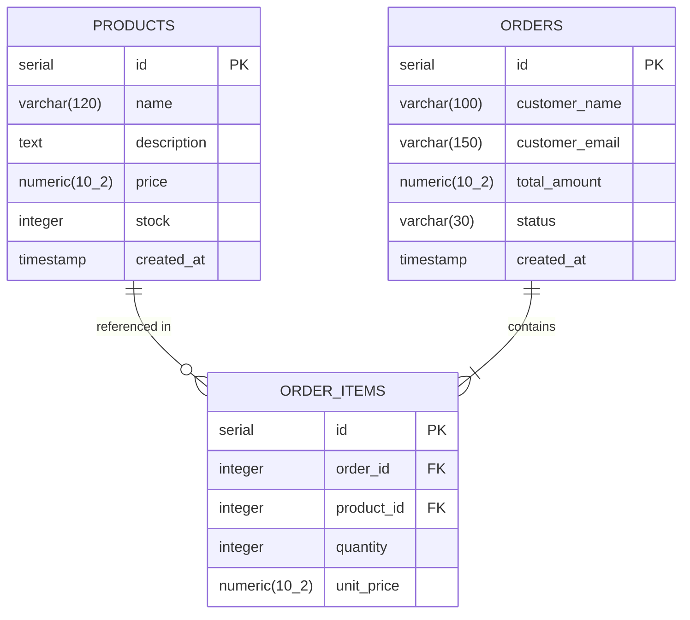
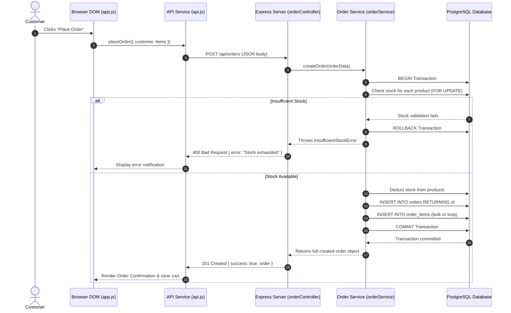

# Report 1: Project Architecture & File Structure

**Project:** E-commerce Order Management System  
**Stack:** Vanilla JavaScript (Frontend) • Node.js & Express (Backend) • PostgreSQL (`pg` driver)  
**Architectural Style:** Decoupled Client-Server Micro-Architecture with RESTful Communication  

---

## 1. System High-Level Architecture

The system follows a strict three-tier separation of concerns:
1. **Presentation Layer (Frontend)**: Runs inside the browser using modern vanilla JavaScript (ES modules). It handles rendering the DOM, listening to user events, and issuing asynchronous HTTP requests via the browser's native `fetch` API.
2. **Application / API Layer (Backend)**: Runs on Node.js using the Express framework. It exposes RESTful HTTP endpoints, parses incoming JSON payloads, validates request parameters, handles business rules, and communicates with the database layer.
3. **Data Layer (PostgreSQL)**: Persists relational data using relational tables (`products`, `orders`, `order_items`). It enforces integrity constraints (foreign keys, check constraints, unique constraints) and handles atomic operations through database transactions.



---

## 2. Directory Layout & File Responsibilities

The project will live in the `e-commerce/` workspace directory. It is divided into an educational learning sandbox (for mastering Async, Promises, Fetch, and SQL) followed by the production application files.

```text
e-commerce/
│
├── learning/                         # Dedicated sandbox for Phase 1 - Phase 3 fundamentals
│   ├── 01_sync_vs_async.js           # Call stack, blocking behavior vs asynchronous timers
│   ├── 02_promises_intro.js          # Promise anatomy: resolve, reject, pending, fulfilled
│   ├── 03_promise_chaining.js        # Sequential execution with .then() and .catch()
│   ├── 04_async_await.js             # Async functions, await operator, and try/catch
│   ├── 05_parallel_execution.js      # Promise.all() and Promise.allSettled()
│   ├── 06_fetch_practice.js          # Public API exploration using Fetch
│   └── 07_sql_practice.sql           # Direct SQL queries & relational practice scripts
│
├── backend/                          # Node.js + Express REST API Server
│   ├── config/
│   │   └── db.js                     # pg Pool setup & connection configuration
│   ├── controllers/
│   │   ├── productController.js      # Handles /api/products HTTP endpoints
│   │   └── orderController.js        # Handles /api/orders HTTP endpoints
│   ├── services/
│   │   ├── productService.js         # Direct SQL queries for inventory & catalog
│   │   └── orderService.js           # Transactional SQL queries for placing orders & items
│   ├── routes/
│   │   ├── productRoutes.js          # Express route definitions for products
│   │   └── orderRoutes.js            # Express route definitions for orders
│   ├── database/
│   │   ├── schema.sql                # Table definitions, constraints, and indexes
│   │   └── seed.sql                  # Initial mock catalog data
│   ├── middleware/
│   │   └── errorHandler.js           # Centralized API error handling middleware
│   ├── package.json                  # Node dependencies (express, pg, dotenv, cors)
│   ├── .env.example                  # Environment variable blueprint (DB credentials, PORT)
│   └── server.js                     # Express app initialization, middleware mounting, listener
│
└── frontend/                         # Vanilla JS Client Application
    ├── index.html                    # Single-page store & order management dashboard
    ├── css/
    │   └── styles.css                # Clean, modern UI styling
    └── js/
        ├── api.js                    # Fetch wrapper for backend endpoints
        ├── cart.js                   # Client-side shopping cart state management
        ├── ui.js                     # DOM rendering (catalog cards, cart table, order history)
        └── app.js                    # Main controller connecting DOM events to API & state
```

---

## 3. Database Schema Design (Entity-Relationship)



### Table Specifications & Integrity Constraints:
1. **`products`**:
   - `id`: `SERIAL PRIMARY KEY`
   - `name`: `VARCHAR(120) NOT NULL UNIQUE`
   - `price`: `NUMERIC(10, 2) NOT NULL CHECK (price >= 0)`
   - `stock`: `INTEGER NOT NULL CHECK (stock >= 0)`
2. **`orders`**:
   - `id`: `SERIAL PRIMARY KEY`
   - `customer_name`: `VARCHAR(100) NOT NULL`
   - `customer_email`: `VARCHAR(150) NOT NULL`
   - `total_amount`: `NUMERIC(10, 2) NOT NULL CHECK (total_amount >= 0)`
   - `status`: `VARCHAR(30) DEFAULT 'PENDING' CHECK (status IN ('PENDING', 'COMPLETED', 'CANCELLED'))`
3. **`order_items`**:
   - `id`: `SERIAL PRIMARY KEY`
   - `order_id`: `INTEGER NOT NULL REFERENCES orders(id) ON DELETE CASCADE`
   - `product_id`: `INTEGER NOT NULL REFERENCES products(id)`
   - `quantity`: `INTEGER NOT NULL CHECK (quantity > 0)`
   - `unit_price`: `NUMERIC(10, 2) NOT NULL` (Freezes historical price at order time)

---

## 4. End-to-End Data Flow: Placing an Order


