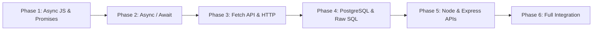

# Report 2: Step-by-Step Briefing Roadmap

**Mentor Policy:** 2 steps delivered at a time • Explanations before code • You type the code • Deep conceptual focus.

---

## Pedagogical Roadmap Overview

---

## Phase 1: Asynchronous JavaScript & Promises (Foundation)
*Focus: Master how the JavaScript engine executes single-threaded code, handles the event loop, and uses Promises for future values.*

### Milestone 1.1: The Call Stack & Asynchronous Reality
- **Step 1:** In `learning/01_sync_vs_async.js`, write a synchronous execution block demonstrating line-by-line blocking behavior.
- **Step 2:** In `learning/01_sync_vs_async.js`, introduce non-blocking execution using `setTimeout` to observe the Event Loop and Macrotask queue.

### Milestone 1.2: Promise Anatomy & Lifecycle
- **Step 3:** In `learning/02_promises_intro.js`, construct a custom Promise from scratch using the `new Promise((resolve, reject) => {})` constructor.
- **Step 4:** In `learning/02_promises_intro.js`, handle consumption of that Promise using `.then()`, `.catch()`, and `.finally()`.

### Milestone 1.3: Chaining & Microtasks
- **Step 5:** In `learning/03_promise_chaining.js`, build a multi-step data processing pipeline returning promises sequentially through `.then()` chaining.
- **Step 6:** In `learning/03_promise_chaining.js`, implement unified error bubbling where a single terminal `.catch()` intercepts errors anywhere in the pipeline.

---

## Phase 2: Modern Asynchronous Syntax (`async` / `await`)
*Focus: Make asynchronous workflows read like clean, synchronous linear code while maintaining non-blocking performance.*

### Milestone 2.1: The `async` & `await` Keywords
- **Step 7:** In `learning/04_async_await.js`, refactor standard promise consumption into an `async function` using the `await` operator.
- **Step 8:** In `learning/04_async_await.js`, handle synchronous and asynchronous errors symmetrically using `try...catch...finally` blocks.

### Milestone 2.2: Concurrency & Performance
- **Step 9:** In `learning/05_parallel_execution.js`, compare slow sequential requests against concurrent execution using `Promise.all()`.
- **Step 10:** In `learning/05_parallel_execution.js`, implement resilient batch resolution using `Promise.allSettled()` to prevent one failure from aborting all tasks.

---

## Phase 3: The Fetch API & Client-Server Communication
*Focus: Master HTTP verbs, request/response bodies, status codes, and network communication.*

### Milestone 3.1: HTTP Fundamentals & GET Requests
- **Step 11:** In `learning/06_fetch_practice.js`, perform a `fetch()` GET request against a public mock API, parsing the response body via `.json()`.
- **Step 12:** In `learning/06_fetch_practice.js`, implement strict HTTP status checks (evaluating `response.ok` and status codes like 404/500).

### Milestone 3.2: Sending Data (POST, PATCH, DELETE)
- **Step 13:** In `learning/06_fetch_practice.js`, craft a `POST` request with custom headers (`Content-Type: application/json`) and a serialized `JSON.stringify()` body.
- **Step 14:** In `learning/06_fetch_practice.js`, encapsulate fetch calls into a reusable, error-handled service function returning UI-safe data states (`data`, `error`, `loading`).

---

## Phase 4: PostgreSQL & Direct SQL Mastery
*Focus: Understand production-grade SQL operations without an ORM, prioritizing data integrity and SQL injection prevention.*

### Milestone 4.1: Database Provisioning & Schema
- **Step 15:** In `backend/database/schema.sql`, write DDL scripts to create the `products`, `orders`, and `order_items` tables with proper data types.
- **Step 16:** In `backend/database/schema.sql`, apply primary keys, foreign keys with referential actions (`ON DELETE CASCADE`), and check constraints (`stock >= 0`).

### Milestone 4.2: CRUD & Querying
- **Step 17:** In `backend/database/seed.sql`, write `INSERT INTO` queries to populate initial catalog products.
- **Step 18:** In `learning/07_sql_practice.sql`, write `SELECT` queries with filtering (`WHERE`, `AND/OR`), sorting (`ORDER BY`), and pagination (`LIMIT/OFFSET`).

### Milestone 4.3: Relational Joins & Transactions
- **Step 19:** In `learning/07_sql_practice.sql`, write an `INNER JOIN` query linking `orders`, `order_items`, and `products` to reconstruct a complete customer receipt.
- **Step 20:** In `learning/07_sql_practice.sql`, write a simulated ACID transaction (`BEGIN`, `UPDATE products`, `INSERT orders`, `COMMIT`) guaranteeing atomic order creation.

---

## Phase 5: Backend API Development (Node.js & Express)
*Focus: Build a robust, modular REST API connecting Express to PostgreSQL via connection pooling.*

### Milestone 5.1: Express Server & Postgres Connection Pool
- **Step 21:** In `backend/package.json` & `backend/server.js`, initialize an Express server with JSON body-parsing middleware and CORS enabled.
- **Step 22:** In `backend/config/db.js`, configure a PostgreSQL connection pool using the `pg.Pool` class reading from environment variables.

### Milestone 5.2: Products REST Endpoints
- **Step 23:** In `backend/services/productService.js`, write database access functions executing parameterized SQL queries (`$1, $2`) for fetching catalog products.
- **Step 24:** In `backend/controllers/productController.js` & `backend/routes/productRoutes.js`, wire HTTP handlers returning products with appropriate HTTP status codes (200, 500).

### Milestone 5.3: Orders REST Endpoints & Transactional Processing
- **Step 25:** In `backend/services/orderService.js`, implement transactional order placement checking stock levels, deducting inventory, and inserting order items.
- **Step 26:** In `backend/controllers/orderController.js` & `backend/routes/orderRoutes.js`, handle `POST /api/orders` and `GET /api/orders/:id` with centralized error handling.

---

## Phase 6: Frontend Integration & End-to-End Application
*Focus: Connect the Vanilla JS frontend to your live Express/Postgres backend for a complete user experience.*

### Milestone 6.1: API Client & Dynamic Catalog Rendering
- **Step 27:** In `frontend/js/api.js`, build an API client module exporting async functions (`fetchProducts`, `submitOrder`, `fetchOrderHistory`).
- **Step 28:** In `frontend/js/ui.js` & `frontend/js/app.js`, asynchronously fetch catalog products on page load and dynamically render product cards into the DOM.

### Milestone 6.2: Cart Management & Order Submission
- **Step 29:** In `frontend/js/cart.js`, maintain in-memory cart state (adding, adjusting quantities, calculating totals against stock).
- **Step 30:** In `frontend/js/app.js`, handle the checkout form submission: dispatch a `POST` request to `/api/orders`, handle loading states, confirm successful orders, and refresh stock availability.
