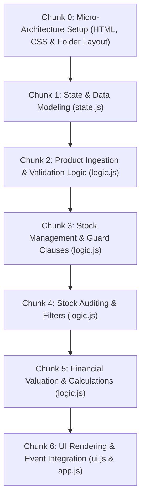

# Inventory Management System — Micro-Architecture & Logic Roadmap

## 🎯 Learning Objectives & Philosophy
- **Focus**: Pure JavaScript logic building, modular design (separation of concerns), and end-to-end data flow into a clean UI.
- **Micro-Architecture Pattern**:
  - **State Layer**: Holds in-memory inventory data.
  - **Logic / Service Layer**: Pure business logic (add, update, detect low/out-of-stock, calculate valuations) independent of DOM.
  - **UI / Presentation Layer**: Renders data into HTML tables/badges and handles DOM events.
  - **App Orchestrator**: Connects UI events to business logic and updates the view.

---

## 🏗️ Project Architecture & File Structure

```text
inventory_manag/
│
├── index.html            # Main UI skeleton & layout
├── styles.css            # Clean, minimal styles for inventory dashboard
├── ROADMAP.md            # Step-by-step logic building plan
│
└── js/                   # Micro-architecture logic modules
    ├── state.js          # In-memory data store & initial state
    ├── logic.js          # Core business rules & calculations (Pure JS)
    ├── ui.js             # DOM manipulation & rendering functions
    └── app.js            # Main controller connecting logic to UI
```

---

## 🗺️ Roadmap & Milestones



---

### Chunk 0: Micro-Architecture Setup & Foundations
**Focus:** Project structure, ES modules (`type="module"`), and semantic UI layout. *(Completed ✅)*

- **Subtopic 0.1: Directory & Module Scaffolding**
  - **Step 1:** Create folder structure (`inventory_manag/`, `inventory_manag/js/`).
  - **Step 2:** Create `index.html` with basic dashboard sections (Add Product Form, Stock Table, Summary/KPI Cards, Alert Badges).
  - **Step 3:** Create `styles.css` for a structured, readable layout (table, cards, status colors).
  - **Step 4:** Link JavaScript using `<script type="module" src="js/app.js"></script>` to enable ES module imports/exports.

---

### Chunk 1: State & Data Modeling (`state.js`)
**Focus:** Memory representation, object schema, and immutability basics.

- **Subtopic 1.1: Product Schema Design**
  - **Step 5:** Define product object structure:
    `{ id: number, name: string, category: string, price: number, quantity: number }`.
- **Subtopic 1.2: State Initialization**
  - **Step 6:** Export default initial `inventory` state with 3–4 realistic mock products.
  - **Step 7:** Write state helper functions (`getInventory()`, `setInventory()`).

---

### Chunk 2: Adding Products & Validation (`logic.js`)
**Focus:** Functions, parameters, input sanitization, and array search.

- **Subtopic 2.1: Input Validation Logic**
  - **Step 8:** Implement `validateProductInput(name, price, quantity)`:
    - Non-empty name.
    - Positive numbers for price and quantity.
- **Subtopic 2.2: Duplicate Detection & Addition**
  - **Step 9:** Implement `addProduct(inventory, newProduct)`:
    - Search if product already exists by name or id (`Array.prototype.find`).
    - If duplicate: increment quantity or return a custom error object.
    - If unique: add to inventory immutably (or append) and return updated list.

---

### Chunk 3: Stock Management & Guard Clauses (`logic.js`)
**Focus:** Pass-by-reference vs copies, defensive conditions (guard clauses).

- **Subtopic 3.1: Product Lookup**
  - **Step 10:** Implement `findProductById(inventory, id)`.
  - **Step 11:** Handle invalid/missing ID safely.
- **Subtopic 3.2: Stock Updates**
  - **Step 12:** Implement `updateStock(inventory, id, deltaQuantity)`:
    - Guard clause: Prevent resulting quantity from dropping below zero.
    - Successfully update and return the modified product and updated state.

---

### Chunk 4: Auditing & Filter Logic (`logic.js`)
**Focus:** Higher-order array methods (`Array.prototype.filter`), query functions.

- **Subtopic 4.1: Out-of-Stock Detection**
  - **Step 13:** Implement `getOutOfStock(inventory)`:
    - Returns array of items with `quantity === 0`.
- **Subtopic 4.2: Low-Stock Detection**
  - **Step 14:** Implement `getLowStock(inventory, threshold = 5)`:
    - Returns array of items where `quantity > 0` and `quantity <= threshold`.

---

### Chunk 5: Financial Metrics & Valuation (`logic.js`)
**Focus:** Accumulators, `Array.prototype.reduce`, math rounding.

- **Subtopic 5.1: Line-Item Value**
  - **Step 15:** Implement `getProductValue(product)` (`price * quantity`).
- **Subtopic 5.2: Total Inventory Valuation**
  - **Step 16:** Implement `calculateTotalValue(inventory)` using `.reduce()`.
  - **Step 17:** Add currency formatting helper (`formatCurrency(amount)`).
- **Subtopic 5.3: (Bonus) Metric Summary**
  - **Step 18:** Implement `getInventorySummary(inventory)` returning total products, total units, out-of-stock count, and total valuation.

---

### Chunk 6: UI Rendering & Event Wiring (`ui.js` & `app.js`)
**Focus:** DOM rendering, table generation, form handling, and event-driven architecture.

- **Subtopic 6.1: Presentation Helpers (`ui.js`)**
  - **Step 19:** Implement `renderInventoryTable(inventory)`: dynamically create table rows with low/out-of-stock badges.
  - **Step 20:** Implement `renderMetricsSummary(summary)`: update KPI cards (Total Value, Total Items, Alerts).
- **Subtopic 6.2: App Orchestration (`app.js`)**
  - **Step 21:** Wire form submission (`Add Product`) -> calls `logic.js` -> updates `state.js` -> triggers `ui.js` re-render.
  - **Step 22:** Wire quick action buttons in table (+ / - stock) -> calls `updateStock()` -> re-renders view.
- **Subtopic 6.3: End-to-End Verification**
  - **Step 23:** Run comprehensive manual tests on all user flows (adding, selling down to zero, preventing negative stock, watching valuation update dynamically).

